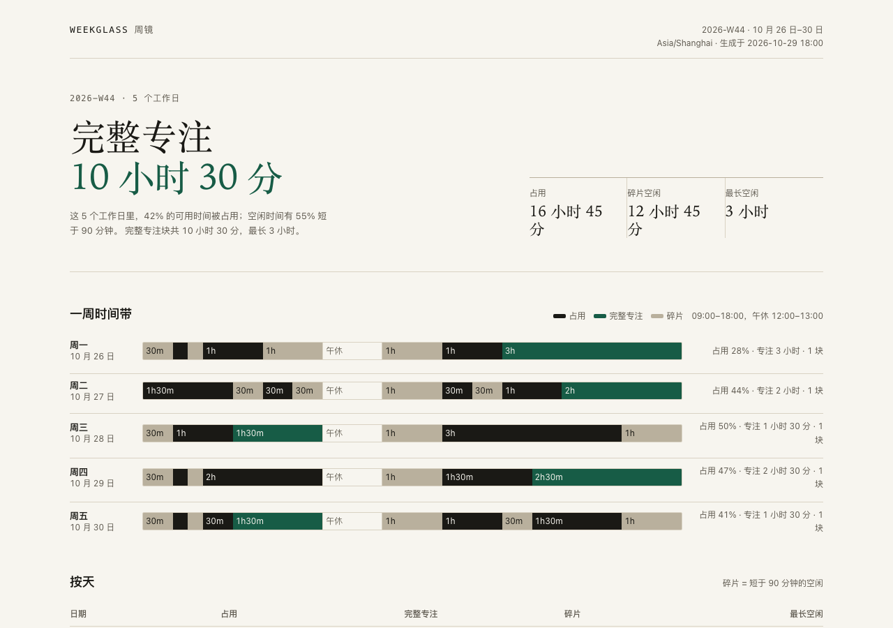

<p align="center"></p>

# Weekglass 周镜

**给每周被会议切碎的人：把 1–20 个 `.ics` 日历变成一张一周时间预算报告，并给出可导入日历的专注块。全程本地。**

[English](README_EN.md) · 简体中文 · Python 3.11+ · MIT · 0.1.0



<sub>示例数据，1280px 浅色报告。深色模式与 375px 见 [assets/report-dark.png](assets/report-dark.png)、[assets/report-mobile.png](assets/report-mobile.png)。</sub>

## 使用前须知

- **只读 `.ics` 文件。** Weekglass 不连接 Google/Microsoft 日历、不要 OAuth、不自动移动或删除任何会议。你需要先从日历导出 `.ics`。
- **不会替你改日历。** 生成的 `focus.ics` 是一个独立文件；导入前请自己确认它和已有安排不冲突。
- **报告含隐私数据。** 事件标题、地点、文件名会出现在 HTML 里。报告不发起网络请求；分享给同事前先检查内容。
- **数字取决于导出的数据。** 重复规则、取消状态、时区如果导出时丢了，Weekglass 无法还原。未知时区会产生提示。
- **0.1.0 只做这一条流程。** 不做任务管理、时间追踪、团队排期、自动预约、云同步。

## 它解决什么

很多人周日晚上想“下周哪几天能安静写东西”，但只能翻日历目测。会议之间的 30–60 分钟既不够进入状态，又继续被切碎；一周结束后也说不清时间去了哪里。

Weekglass 把这件事变成三个可核对的问题：

1. 这一周有多少可用时间被占用？
2. 空闲被切成了多少段，碎片率是多少？
3. 下周可以把哪几块完整时间放回日历？

它不预测、不评分、不评判你的效率，只把时间预算摊开。

## 功能

### 多日历合并，先算清楚

读取 1–20 个 `.ics`，展开重复事件，合并重叠，跨日历去重；取消事件不计，透明事件不占，暂定事件按占用。所有时间统一到配置的 IANA 时区。

[功能细节与字段 →](docs/features.md#1-读多个-ics合并成一周)

### 一周时间预算

按天算可用时间、占用、完整专注、碎片、最长空闲、背靠背、工时外和周末。默认工作窗口 09:00–18:00，午休 12:00–13:00，完整专注门槛 90 分钟；都能改。

终端直接给结论：

```
占用        16 小时 45 分 / 40 小时（42%）
完整专注    10 小时 30 分（5 块）
碎片空闲    12 小时 45 分（占空闲 55%）
最长空闲    3 小时
```

[指标口径 →](docs/features.md#2-一周时间预算) · [计算公式 →](SPEC.md#63-每天指标)

### 专注块建议

从空闲段按 15 分钟对齐，单块最多 180 分钟；优先更长、上午、周二至周四；默认每天 1 个、总共 3 个。不会覆盖已有会议，也不会跨午休。

```bash
weekglass plan work.ics personal.ics --week 2026-10-26 --out focus.ics
```

[建议规则 →](docs/features.md#3-专注块建议)

### 可导入的专注块

`focus.ics` 里每个建议是一个独立事件：UTC 时间、固定 UID、`TRANSP:OPAQUE`、`CATEGORIES:专注`。导入 Google/Outlook/Apple 日历后，你仍然可以手动移动它。

[生成规则 →](docs/features.md#4-可导入的-ics)

### 单文件 HTML 报告

一张本地 HTML：一周时间带、按天表格、建议、算法说明、数据来源、可折叠事件明细。无 JavaScript、无外部字体/图片/请求；跟随系统浅色/深色；375px 单列可读。

[报告说明 →](docs/features.md#5-单文件-html-报告) · [设计规则 →](DESIGN.md)

### 可复现、可核对

- 无网络、无账号、无遥测；只读输入文件。
- `WEEKGLASS_NOW` 或 `--now` 固定时钟；同输入同时间输出一致。
- 输出默认拒绝覆盖，`--force` 才覆盖；写入使用同目录临时文件 + 原子替换。
- 统一中文错误和退出码 2/3/4/5/6/7/8，错误说明写清“哪里、为什么、下一步”。

[确定性与错误 →](docs/features.md#6-确定性隐私与错误) · [完整契约 →](SPEC.md)

## 适用于 / 不适用于

**适用于：**

- 用 Google Calendar、Outlook 或 Apple 日历，能导出 `.ics` 的知识工作者、研究生、独立开发者；
- 每周有 5 个以上会议，想把会议集中、给深度工作留完整块的人；
- 在意隐私，不想把日历授权给云端 SaaS，或需要把分析结果留档的人。

**不适用于：**

- 需要自动移动会议、团队排期、预约链接的人：用日历自带预约页或 Reclaim/Clockwise 类工具；
- 需要任务管理、时间追踪、番茄钟、习惯打卡的人：Weekglass 只读日历，不管理任务；
- 只用一个日历、几乎没有会议，或不愿意导出 `.ics` 的人：手写时间块更快。

## 快速开始

### 前置条件

- Python 3.11 或更高版本；
- 能导出 `.ics` 的日历（Google Calendar、Outlook、Apple 日历等）；
- 不需要账号、API key、服务器或网络。

### 安装

```bash
python3 --version
python3 -m venv .venv
. .venv/bin/activate
python -m pip install -e .
```

Windows 激活虚拟环境用 `.venv\Scripts\activate`。

### 先看示例

```bash
weekglass demo --out weekglass-demo
```

会生成 `work.ics`、`personal.ics`、`focus.ics`、`report.json`、`report.html`。用浏览器打开 `weekglass-demo/report.html`。示例固定 `2026-W44`、`Asia/Shanghai`，不读取你的日历。

重复运行需要 `--force`：

```bash
weekglass demo --out weekglass-demo --force
```

### 用你自己的日历

1. 从日历导出 `.ics`。Google Calendar：设置 → 导入和导出 → 导出；Outlook：设置 → 日历 → 共享日历 → 发布/下载；Apple 日历：选中日历 → 文件 → 导出 → 导出为 `.ics`。不同版本菜单不同，认准 `.ics` 扩展名。
2. 运行：

```bash
weekglass audit work.ics personal.ics \
  --week 2026-10-26 \
  --timezone Asia/Shanghai \
  --html report.html \
  --plan-out focus.ics
```

3. 打开 `report.html`；确认建议后，把 `focus.ics` 导入日历。

`--week` 给这一周任意一天即可，内部归一到周一。默认是今天所在周。

### 最小配置

所有配置都是可选的；下表是最常用的几个。完整列表、默认值、非法值行为见 [SPEC §2](SPEC.md#2-配置)。

| 变量 | 默认 | 说明 |
|---|---|---|
| `WEEKGLASS_TZ` | 系统时区 | IANA 时区，例如 `Asia/Shanghai` |
| `WEEKGLASS_WORK_START` / `WEEKGLASS_WORK_END` | `09:00` / `18:00` | 工作窗口 |
| `WEEKGLASS_LUNCH_START` / `WEEKGLASS_LUNCH_END` | `12:00` / `13:00` | 午休；必须落在工作窗口内；都写 `off` 表示不计午休 |
| `WEEKGLASS_MIN_FOCUS_MINUTES` | `90` | 完整专注的最短分钟数 |
| `WEEKGLASS_NOW` | 当前时间 | 带偏移的 ISO 时间；用于复现，不用于日常 |

示例文件见 [.env.example](.env.example)。Weekglass 不会自动读取 `.env`；请用 `export`、shell 配置或直接在命令里加参数。

## 命令

| 命令 | 用途 |
|---|---|
| `weekglass audit CALENDAR...` | 分析一周，输出摘要，可选 JSON/HTML/专注块 |
| `weekglass plan CALENDAR... --out PATH` | 只生成专注块 `.ics` |
| `weekglass demo --out DIR` | 生成固定示例 |
| `weekglass version` | 显示版本；`--json` 输出机器可读版本 |
| `weekglass --help` | 命令列表 |

所有参数、退出码、JSON 字段见 [SPEC §3–§5](SPEC.md#3-通用-cli-约定)。

## 升级

用新版本代码替换目录后，重新安装并确认版本：

```bash
python -m pip install -e .
weekglass --version
```

没有数据库、迁移或后台状态；旧报告不会被自动改写。

## 文档

- [SPEC.md](SPEC.md)：唯一契约（命令、字段、算法、错误、测试）
- [DESIGN.md](DESIGN.md)：报告设计、token、375px 规则
- [docs/features.md](docs/features.md)：用户可见功能
- [docs/development.md](docs/development.md)：环境、目录、测试、打包
- [docs/deviations.md](docs/deviations.md)：偏离记录
- [docs/external-apis.md](docs/external-apis.md)：外部接口核对（0.1.0 无运行时网络接口）
- [docs/选题.md](docs/选题.md)：为什么做这个、竞品和证据
- [notes/决定.md](notes/决定.md)：关键决定
- [CHANGELOG.md](CHANGELOG.md)：版本变更

## 开发

```bash
python -m pip install -e '.[dev]'
pytest -q
```

测试全部离线、使用临时目录和固定时钟；不读取真实日历，不跳过。设计 token 和 375px 规则有独立测试。

## 已知限制

- 未知 `TZID` 会按配置时区解释，并在终端/报告里指出具体 TZID；不认识的时区仍可能造成偏移。
- 夏令时回拨的重复 wall clock 没有唯一标记，同一 wall clock 的两个事件可能被合并。
- 生成 `.ics` 使用 UTC，不写 VTIMEZONE；主流客户端可导入，极旧客户端可能不识别显示时区。
- 报告只显示来源文件名，不显示绝对路径；JSON 保留传入路径，分享 JSON 前请检查。
- 直接用 `--html`/`--json` 写文件时，POSIX 权限为 0600；用 shell `>` 重定向时权限由 shell/umask 决定（常见 0644）。Windows 不保证同等权限。

## 许可证

MIT。见 [LICENSE](LICENSE)。
